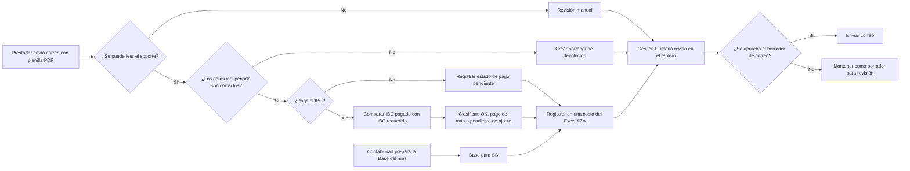

# Validador de soportes de pago de seguridad social

[](https://github.com/felipegarcian/validador-ss/actions/workflows/pruebas.yml)

Herramienta para validar soportes de pago de seguridad social frente a la liquidación mensual y generar un Excel maestro auditable junto con borradores de correo para revisión. Hace parte del reto **Validación de soportes de pago de seguridad social** de **Inteligencia artificial**, desarrollado para AZA Gestión del Riesgo.

> **Estado del proyecto:** el flujo local de validación, generación del Excel y borradores funciona con datos ficticios. El carril 2 con Claude funciona sin API (copiar y pegar guiado) y el motor puede trabajar sobre una carpeta de SharePoint alimentada por Power Automate. Falta probar los flujos de Power Automate en el tenant de AZA y construir el tablero de aprobación.

## Tabla de contenido

- [Equipo](#equipo)
- [Flujo general](#flujo-general)
- [Funcionalidades y estado](#funcionalidades-y-estado)
- [Requisitos](#requisitos)
- [Instalación y uso](#instalación-y-uso)
- [Configuración](#configuración)
- [Estructura del proyecto](#estructura-del-proyecto)
- [Privacidad y seguridad de datos](#privacidad-y-seguridad-de-datos)
- [Contribuir](#contribuir)
- [Versiones y cambios](#versiones-y-cambios)
- [Licencia](#licencia)
- [Documentación](#documentación)

## Equipo

- **Equipo:** E-8ZN8 HTTPS 200 SOLUTIONS
- **Integrantes:**
  - Angelica Yelixce Villamil Carvajal — [@angieVilla](https://github.com/angieVilla)
  - Tomas Vargas Muneton — [@Tomy1714](https://github.com/Tomy1714)
  - Simon Vargas Muneton
  - Luis Felipe Garcia Naranjo — [@felipegarcian](https://github.com/felipegarcian)
  - Manuela Villa Rojas — [@Manuelavilla](https://github.com/Manuelavilla)
  - Rafael Angel Gonzalez Reyes — [@Rafagnlz](https://github.com/Rafagnlz) (Rafiki)
  - Santiago Duque Torres

## Flujo general

El siguiente diagrama resume el flujo funcional previsto. La lectura local y la generación del Excel y los borradores están implementadas; las integraciones con Outlook/Office 365 y el tablero siguen pendientes.



El envío de correos requiere aprobación humana. El diagrama describe el proceso objetivo y no implica que las integraciones pendientes ya estén disponibles.

## Funcionalidades y estado

| Componente | Estado |
|---|---|
| Esquema de datos, reglas y estados de validación | Implementado y probado |
| Cálculo de días hábiles y festivos de Colombia | Implementado y probado |
| Lectura de planillas mediante plantillas | SuAporte y Compensar en Python; nuevas plantillas en YAML (`plantillas_operador/`) que Claude propone y TI prueba con `scripts/probar_plantilla.py` |
| Apertura de PDF con contraseña y orden de claves | Implementado y probado |
| Excel maestro y borradores de correo | Funcionan en local |
| Inspección asistida por Claude (carril 2) | Implementada sin API: paquete con datos personales tapados para el Claude de AZA ([guía](docs/CARRIL2_CLAUDE.md)) |
| Integración con Office 365 | Adaptador de carpeta implementado; flujos de Power Automate documentados, pendientes de montar en AZA ([guía](docs/AUTOMATIZACION_O365.md)) |
| Datos del tablero (`tablero_AAAA-MM.json`) y verificador de cifras | Implementado y probado; el adaptador de carpeta lo deja en `Salidas/` |
| Tablero para aprobación de correos | Prototipo visual aparte; estrategia y paso a paso en [docs/TABLERO.md](docs/TABLERO.md) |

La validación se realiza con reglas deterministas. Los parámetros del proceso, como la tolerancia y el día de corte, se mantienen en `config/reglas.yaml`.

## Requisitos

- Python 3.10 o superior
- `pip`
- Git (para clonar el repositorio)

La dependencia opcional `pdf` instala herramientas de lectura de PDF. No es necesaria para ejecutar las pruebas ni la demostración básica.

## Instalación y uso

Clona el repositorio y entra a su carpeta:

```bash
git clone https://github.com/felipegarcian/validador-ss.git
cd validador-ss
```

### Windows (PowerShell)

```powershell
python -m venv .venv
.venv\Scripts\Activate.ps1
pip install -e ".[dev]"
pytest -q
python -m validador.demo
```

### Linux o macOS

```bash
python -m venv .venv
source .venv/bin/activate
pip install -e ".[dev]"
pytest -q
python -m validador.demo
```

La demostración usa datos ficticios y crea `demo_salida/` con una liquidación de ejemplo, doce prestadores ficticios y el Excel maestro generado. La carpeta de salida está excluida de Git.

Para instalar también las dependencias opcionales de lectura de PDF:

```bash
pip install -e ".[dev,pdf]"
```

## Configuración

Los parámetros de validación se definen en `config/reglas.yaml`. Revísalos antes de adaptar el proceso a otro periodo o procedimiento.

El archivo `.env.example` documenta variables previstas para integraciones todavía no implementadas. No se requieren para ejecutar localmente las pruebas y la demostración. Nunca incluyas credenciales en el código ni compartas el archivo `.env`.

## Estructura del proyecto

```text
src/validador/
  esquema.py          Modelos, estados y resultados
  reglas.py           Validación determinista de soportes
  calendario.py       Días hábiles y festivos de Colombia
  expectativas.py     Carga de la liquidación del mes
  conciliacion.py     Estado mensual, bitácora y corte
  lectura/            Lectura por plantillas, claves de PDF e inspección
  adaptadores/        Adaptadores locales y previstos para Office 365
  salidas/            Excel maestro, borradores de correo, datos del tablero y verificador de cifras
config/               Parámetros del proceso
plantillas_operador/  Guía para agregar plantillas de operadores
docs/                 Instalación, pruebas, operación y soporte
tests/                Pruebas automáticas con datos ficticios
```

## Privacidad y seguridad de datos

- No agregues datos reales de personas ni soportes reales al repositorio.
- `datos_reales/`, los archivos PDF y `.env` están excluidos de Git.
- Usa exclusivamente datos ficticios de `validador.demo` y `tests/fixtures` para desarrollar y probar.
- La Base para SS original no se sobrescribe: el proceso genera una copia diligenciada.
- Los correos son borradores y requieren aprobación humana; el sistema no los envía automáticamente.

## Contribuir

Lee la [guía de contribución](CONTRIBUTING.md) antes de proponer cambios. En resumen, usa datos ficticios, agrega pruebas para cambios de comportamiento y abre una solicitud de cambios con las comprobaciones locales en verde.

## Versiones y cambios

El proyecto sigue [Semantic Versioning 2.0.0](https://semver.org/): la versión se mantiene en `pyproject.toml` y los cambios publicados se documentan en [CHANGELOG.md](CHANGELOG.md), siguiendo [Keep a Changelog 1.1.0](https://keepachangelog.com/en/1.1.0/). Los mensajes de commit siguen [Conventional Commits 1.0.0](https://www.conventionalcommits.org/en/v1.0.0/). La guía de contribución detalla cómo aplicar esta política, incluido el estado previo a la versión 1.0.0.

## Licencia

Este proyecto se distribuye bajo la licencia [MIT](LICENSE).

## Documentación

- [Instalación en la infraestructura de AZA](docs/INSTALACION.md)
- [Plan de pruebas](docs/PRUEBAS.md)
- [Operación y soporte](docs/OPERACION.md)
- [Carril 2 con el Claude de AZA](docs/CARRIL2_CLAUDE.md)
- [Disparadores automáticos con Power Automate](docs/AUTOMATIZACION_O365.md)
- [Guía para plantillas de operadores](plantillas_operador/README.md)
- [Tablero y Claude: estrategia e implementación](docs/TABLERO.md)
